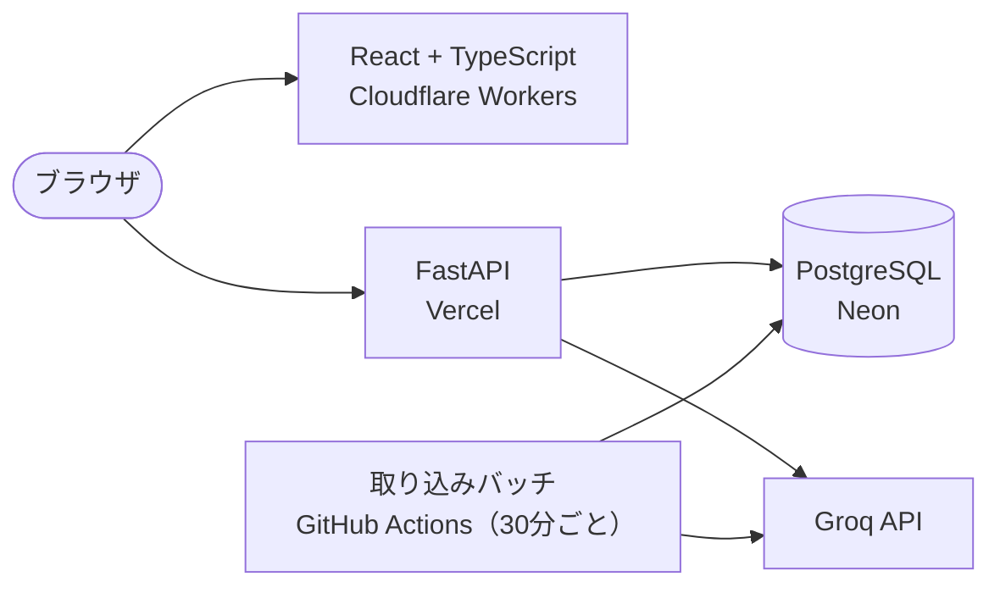

# Riku Kondo（近藤 璃空）

立命館大学 情報理工学部 3回生（2028年卒予定）。FastAPI と React / TypeScript でWebアプリを作っています。

- 作ったものを自分で使い、使って気づいた不便を設計の変更で直すという進め方をしています
- 開発にはAIを使います。設計の判断は自分で行い、その理由を記録に残しています

## 作ったもの

### [Newscrape](https://github.com/rknd24/Newscrape)　広告なしで、ニュースをAIの要約つきで読むWebアプリ

| 項目 | 内容 |
|---|---|
| 公開URL | https://newscrape-front.rknd24.workers.dev/ （ログイン不要） |
| できること | ニュースの一覧、3段（経緯 / ポイント / 影響）の要約、記事ごとのAIへの質問、キーワード検索 |
| 技術 | React 19 / TypeScript / MUI、FastAPI / SQLAlchemy、PostgreSQL（Neon）、Groq API |
| 動かしている場所 | Cloudflare Workers（フロント）、Vercel（API）、GitHub Actions（30分ごとの取り込み） |
| 期間 | 2026年4月〜（個人開発） |

自分と母、友達に使ってもらって気づいたことから、設計を変えてきました。

| 使って気づいたこと | 変えたこと |
|---|---|
| 「要約」を押してから待たされると、読む気が落ちる | 要約を、記事の取り込み時に作っておく構成に変えた。押したときの待ち時間はない |
| 母に使ってもらい、「大谷」では見つかる記事が「大谷翔平」では見つからないと指摘された | 検索の対象を、見出しだけから本文にも広げた |
| AIへの質問の答えが浅い | 表示中の全記事ではなく、選んだ1記事の本文だけをAIに渡す形に変えた |

設計の判断と、AIとの分担は [README](https://github.com/rknd24/Newscrape#readme) に書いています。

### [WebCraft](https://github.com/rknd24/webcraft)　Web技術を4択で学ぶ学習アプリ（開発中）

NewscrapeではDB設計をAIに任せました。その反省から、WebCraftではDB設計から自分で行っています。

| 項目 | 内容 |
|---|---|
| 状況 | 仕様・ER図・テーブル定義・マイグレーションまで完了。API・画面・認証はこれから（2026年11月時点） |
| 技術 | FastAPI / SQLAlchemy 2.1 / Alembic、PostgreSQL（Docker Compose） |
| 設計の記録 | [ADR（設計判断の記録）](https://github.com/rknd24/webcraft/tree/main/docs/adr)、[ER図](https://github.com/rknd24/webcraft/blob/main/docs/er.md)、[スプリントごとの振り返り](https://github.com/rknd24/webcraft/blob/main/docs/retro.md) |
| 設計で間違えたこと | 選択肢のテーブルを最初は誤った形で作り、直した。経緯は [仕様書の設計メモ](https://github.com/rknd24/webcraft/blob/main/docs/spec.md) に書いた |

## スキル

個人開発で使っているもの

授業のチーム開発で使ったもの

| 分野 | 技術 | 使った場所 |
|---|---|---|
| バックエンド | Python / FastAPI / SQLAlchemy / Pydantic / Alembic / pytest | Newscrape、WebCraft |
| フロントエンド | TypeScript / React / Vite / MUI | Newscrape |
| DB | PostgreSQL / SQLite | Newscrape、WebCraft |
| インフラ | Cloudflare Workers / Vercel / GitHub Actions / Docker Compose | Newscrape、WebCraft |
| ゲーム開発 | Unity | 授業のチーム開発 |

## 開発の進め方

- 大事だと思ったところはまず自分でコードを書く。分からないところはAIに書いてもらい、納得するまで質問する
- DB設計や認証など判断が必要な部分は、自分が先に案を書き、AIにはレビューを頼む
- 大きな設計判断は、理由と諦めたことをできるだけADRに残すようにする
- ブランチを切ってPRを出し、差分を自分で読んでからマージする

## チーム開発・インターン

| 時期 | 内容 |
|---|---|
| 2026年11月 | 授業で6人チームのMRゲーム（Unity / Meta Quest 3）を開発中。リポジトリとプロジェクトの立ち上げ、プログラマを担当 |
| 2026年11月 | クリエーションライン 3日間インターン（AI駆動開発）に参加 |
| 2026年8月 | ラクス Tech Lab（3日間）に参加 |
| 2026年4〜7月 | 授業で4人チームのVRゲーム（Unity）を開発。メニューやチュートリアルなどのUIを担当 |

## 資格

- 基本情報技術者試験（2026年3月合格）

<!--
統計カードを出すとき：
1. このリポジトリに .github/workflows/cards.yml を置く
2. Actions タブから「Update README cards」を手動で1回実行し、profile/top-langs.svg ができたのを確認する
3. 下の2行のコメントを外す

## よく使う言語

-->
