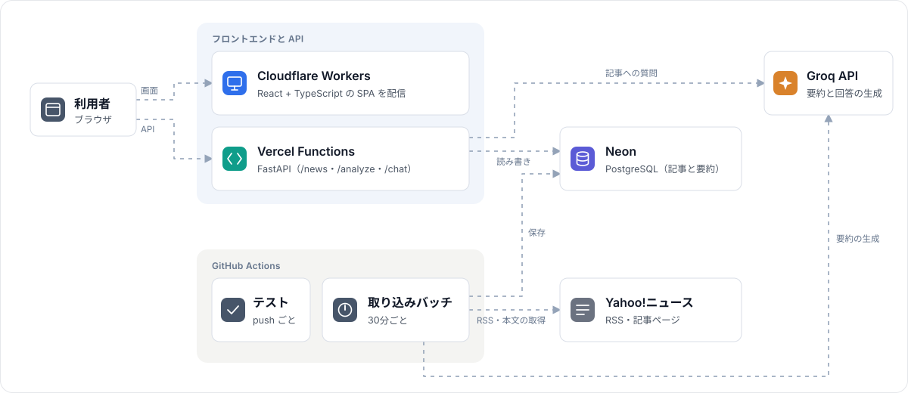

# Riku Kondo（近藤 璃空）

立命館大学 情報理工学部 3回生（2028年卒予定）。FastAPI と React / TypeScript などでWebアプリを作っています。

- 作ったものを自分で使い、使って気づいた不便を設計の変更で直すという進め方をしています
- 開発にはAIを使います。設計の判断は自分で行い、その理由を記録に残しています

## 作ったもの

### [Newscrape](https://github.com/rknd24/Newscrape)　広告なしで、ニュースをAIの要約つきで読むWebアプリ

**[公開URL](https://newscrape-front.rknd24.workers.dev/)**（ログイン不要）｜2026年4月〜、個人開発

自分と母、友達が使って気づいた不便を、設計の変更で直してきました。設計の判断と、AIとの分担は [README](https://github.com/rknd24/Newscrape#readme) に書いています。

### [WebCraft](https://github.com/rknd24/webcraft)　Web技術を4択で学ぶ学習アプリ（開発中）

NewscrapeではDB設計をAIに任せました。その反省から、WebCraftではDB設計から自分で行い、判断の理由を [ADR](https://github.com/rknd24/webcraft/tree/main/docs/adr) に残しています。テーブル定義とマイグレーションまで完了しました（2026年11月時点）。

## スキル

個人開発で使っているもの

授業のチーム開発で使ったもの

## 開発の進め方

- 大事だと思ったところはまず自分でコードを書く。分からないところはAIに書いてもらい、納得するまで質問する
- DB設計や認証など判断が必要な部分は、自分が先に案を書き、AIにはレビューを頼む
- 大きな設計判断は、理由と諦めたことをADRに残す
- ブランチを切ってPRを出し、差分を自分で読んでからマージする

## チーム開発・インターン

| 時期 | 内容 |
|---|---|
| 2026年11月 | 授業で6人チームのMRゲーム（Unity / Meta Quest 3）を開発中。リポジトリとプロジェクトの立ち上げ、プログラマを担当 |
| 2026年11月 | クリエーションライン 3日間インターン（AI駆動開発）に参加 |
| 2026年8月 | ラクス Tech Lab（3日間）に参加 |
| 2026年4〜7月 | 授業で4人チームのVRゲーム（Unity）を開発。メニューやチュートリアルなどのUIを担当 |

## 資格

- 基本情報技術者試験（2026年3月合格）
